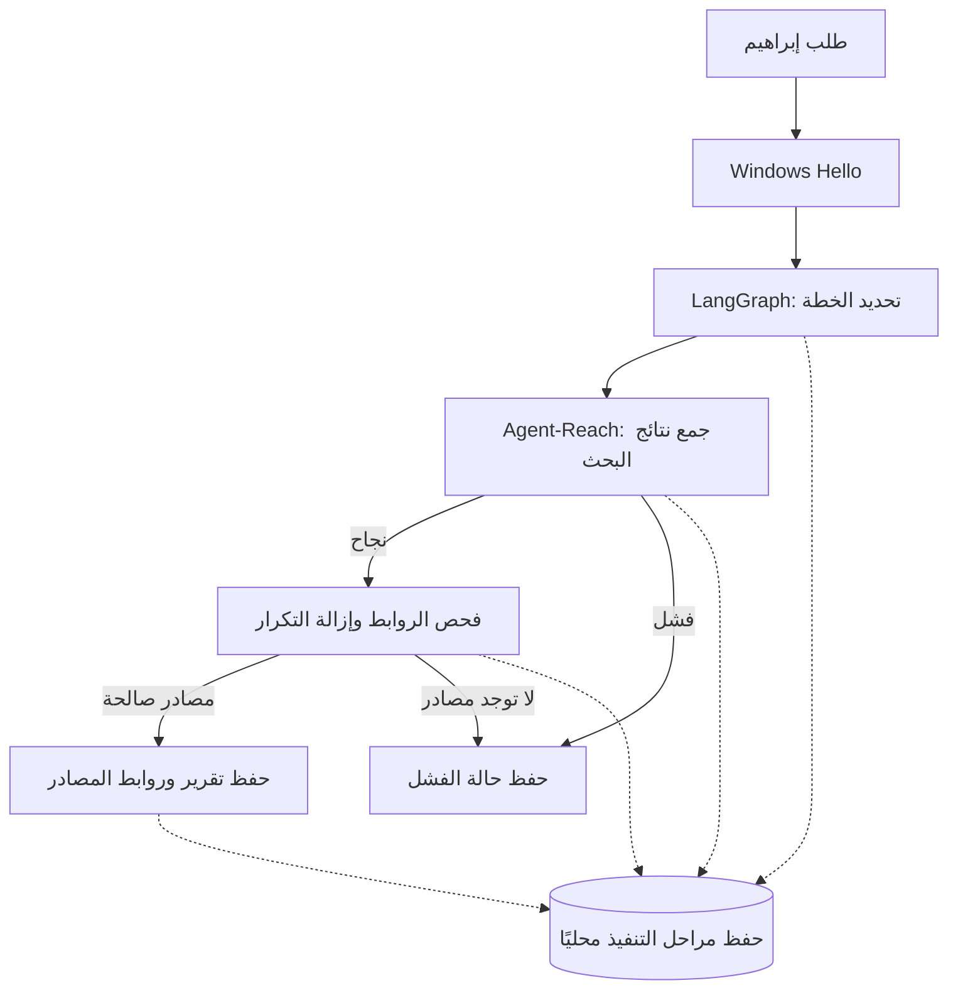

# مسار دمج X وتنفيذه

## المرحلة الأولى — منفذة ومختبرة

LangGraph 1.2.18 مع langgraph-checkpoint-sqlite 3.1.2، تحت MIT، في بيئة مستقلة D:/X-System/runtime/x-workflow-venv. لا اشتراك مدفوع أو مفتاح استدلال مطلوب لهذا المسار؛ تتبع LangSmith معطل. بحث Agent-Reach يستخدم حاليًا خدمة Exa الخارجية بلا مفتاح، وقد تخضع لحصص أو تغييرات؛ ليس محرك بحث محليًا بالكامل.



هذا مسار محدد من أربع خطوات وليس أربعة وكلاء مستقلين أو فريقًا يعمل في الخلفية. لا يتخذ نموذج لغوي قرارات تنفيذ في هذا الإصدار. فحص الروابط لا يثبت صحة الادعاءات الموجودة بالمصادر.

### التشغيل

```powershell
.\X.cmd workflow --query "سوق العقارات في عجمان" --limit 3
.\X.cmd workflow --channel github --query "local ai memory" --limit 3
.\X.cmd workflow --resume "رقم-المهمة-الظاهر-بعد-تشغيلها"
```

Workflow-X.cmd يفتح طلب بحث مباشرة. زر «تنفيذ مهمة بحث» يظهر بعد إعادة فتح لوحة X Live. كل مرحلة تسجل في اللوحة عند تنفيذها فعلًا. لا توجد جدولة دورية أو تشغيل تلقائي عند بدء Windows.

الحفظ: D:/X-System/data/workflows/checkpoints.sqlite، ولكل مهمة مجلد يحوي report.md وresult.json وevents.jsonl. عند استكمال مهمة مكتملة يعاد ناتجها دون تكرار البحث؛ عند استكمال مهمة توقفت باستثناء تقني تستأنف العقدة التي لم تكتمل. فشل خدمة البحث الصريح ينهي المهمة بحالة failed؛ يبدأ المستخدم مهمة جديدة لإعادة المحاولة. إعادة عقدة انقطعت قد تكرر طلب القراءة الخارجي؛ لا توجد أفعال إرسال أو نشر في هذا المسار.

اختبارات: نجاح المسار وحفظ التقرير وإزالة الروابط المكررة؛ عدم إصدار تقرير ناجح عند فشل البحث؛ استئناف انقطاع تجريبي دون تكرار مرحلة الخطة؛ منع تشغيل المسار عند فشل الهوية. التحقق المباشر جمع مصادر رسمية لعجمان وحفظ التقرير، موثق في workflow-verification.json. الاختبارات الداخلية لا تتجاوز بوابة Hello للاستخدام التفاعلي.

## مسار المكونات التالية — مخطط ولم ينفذ بعد

1. **ذاكرة محلية:** تجربة Mem0 المفتوح مع Ollama وإعداد استرجاع محلي؛ منع إرسال الذاكرة إلى المنصة السحابية، وتحديد ما يحفظ وما يحذف.
2. **استخراج الصفحات:** تجربة Crawl4AI لقراءة عامة محلية؛ إضافة مصادره إلى Workflow بعد قياس ARM64 والتراخيص.
3. **المتصفح:** توصيل Playwright الموجود بأفعال محددة، واختبار الجلسة والصلاحيات لكل حساب بصورة منفصلة.
4. **القنوات:** تقييم موصلات OpenClaw المناسبة لـX، دون تركيب محرك ثانٍ وتكرار الذاكرة تلقائيًا.
5. **الملفات والصوت:** Docling، ثم Silero VAD، مع إبقاء مسار ONNX الحالي وصوت حسن حتى يثبت بديل أفضل.
6. **المحتوى والتكاملات:** FFmpeg ثم Postiz وActivepieces Community عند الحاجة، مع صلاحيات الخدمات الرسمية.

الشخصية على Ollama خطوة مستقلة بعد تثبيت حدود الأدوات والذاكرة. إدارة العملاء مؤجلة حسب طلب إبراهيم. لا تعني هذه الخريطة تثبيت كل المكونات أو ربط حسابات السوشيال؛ المنفذ هنا هو محرك Workflow ومسار البحث وحفظ المراحل والتقارير.
